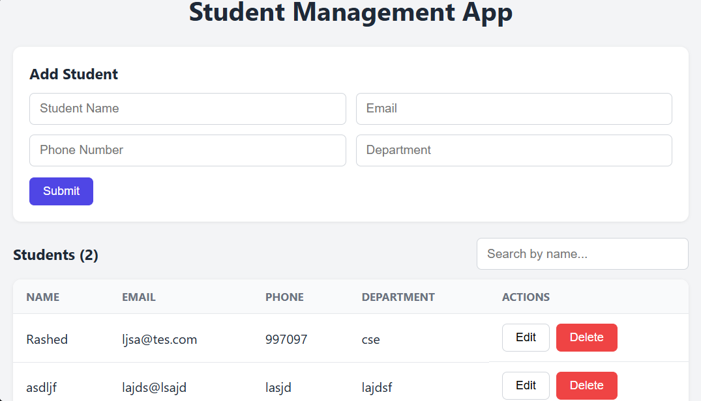

# Student Management App

A simple React app to add, view, search, edit and delete students.
Data is saved in the browser's LocalStorage.

## Features
- Add student (name, email, phone, department)
- Student list with Delete and Edit
- Search by name
- Total student count
- LocalStorage persistence
- Responsive design (table turns into cards on mobile)

## Run locally
```bash
npm install
npm run dev
```
